# 👩‍💻 Nonhlanhla Hazel Mahlangu Digital Portfolio

## 👤 About Me
I am a third-year ICT in Application Development student at Cape Peninsula University of Technology (CPUT), passionate about software development, problem solving, and building technology solutions that create impact.

---

# 📄 Curriculum Vitae (CV)

## 🧾 Profile
Third-year ICT Application Development student with a foundation in Java, Python, HTML, CSS, JavaScript and MySQL. Experienced in academic projects including CampusMate and AfriMed. Interested in internship and graduate opportunities.

## 📞 Contact
- Phone: +27 71 302 2218
- Email: 222687290@mycput.ac.za
- Location: Cape Town, Western Cape

## 🎓 Education
### Cape Peninsula University of Technology (CPUT)
- Diploma in ICT Application Development  
- 2024 – Present

### Senzangakhona Secondary School
- National Senior Certificate  
- Completed 2021

## 💻 Technical Skills
- Java
- Python
- HTML
- CSS
- JavaScript
- MySQL
- NetBeans
- Data Analytics (Currently Learning)

## 🚀 Academic Projects

### 🏥 AfriMed
Healthcare medication delivery solution for rural communities.

- Assisted with system concept
- Contributed to solution design
- Focused on accessibility and healthcare challenges

### 🏫 CampusMate
Campus healthcare management system.

- Contributed to feature design
- Worked on healthcare service concepts
- Applied database and UI design skills

---

# 🎥 Mock Interview Video

[▶️ Watch My Mock Interview Here](https://youtu.be/4PH4nADHCgw)

---

# 📝 Reflection on Coding in Markdown (STAR Method)

## Situation
I had to create a digital portfolio using GitHub and Markdown.

## Task
My task was to code a professional CV and portfolio using Markdown.

## Action
I learned Markdown syntax, structured my portfolio using headings and lists, and organized my evidence professionally.

## Result
✅ I successfully created a digital portfolio using GitHub and improved my technical documentation skills.

---

# 🎤 Reflection on Mock Interview (STAR Method)

## Situation
I had to complete a mock interview as part of work readiness training.

## Task
My task was to answer interview questions professionally and demonstrate communication skills.

## Action
I prepared answers, practiced speaking confidently, and recorded the interview video.

## Result
✅ I improved my confidence, communication, and interview preparation skills.

---

# 🌐 Reflection on GitHub Pages (STAR Method)

## Situation
I needed to publish my portfolio online.

## Task
My task was to deploy my GitHub portfolio using GitHub Pages.

## Action
I configured GitHub Pages and published my repository as a live website.

## Result
✅ I successfully created a live digital portfolio that can be shared professionally.

---

## 🤝 Agile Team Charter

### 📸 Evidence
Team charter for **Pretoria Prime Recycling**, our door-to-door recycling service for Silver Lakes, Pretoria.

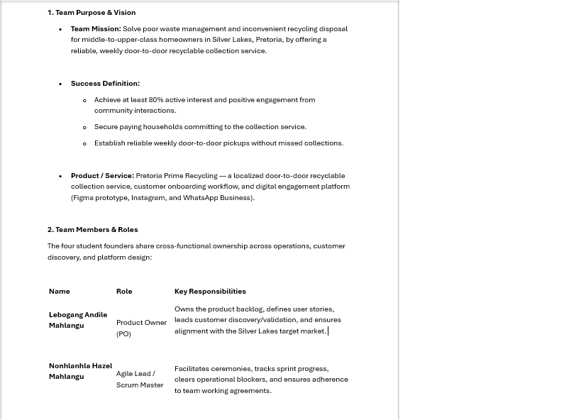

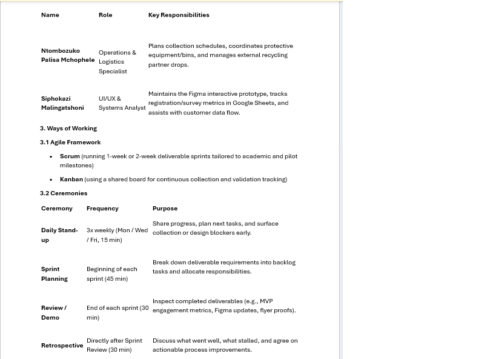

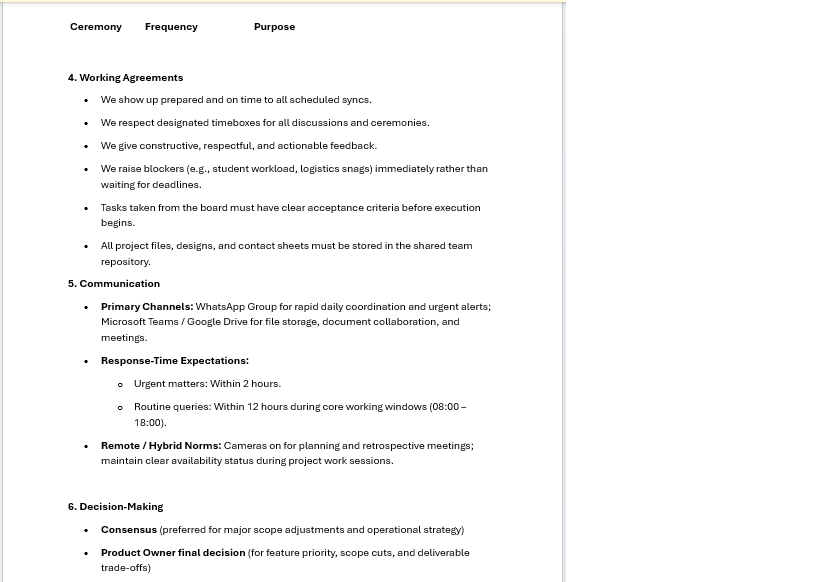

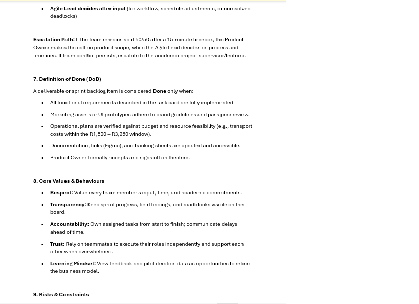

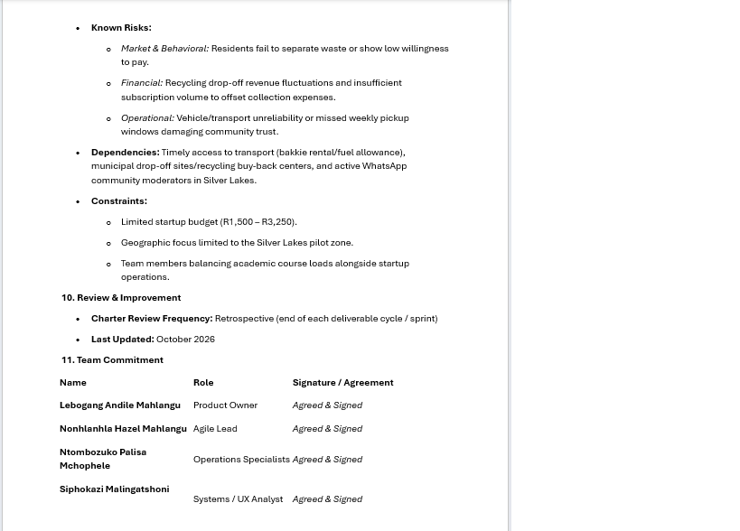

### 📝 Reflection on the Agile Team Charter (STAR Method)

**Situation**
Our team of four student founders was starting Pretoria Prime Recycling while also carrying full academic loads. We needed a shared agreement on how we would work together before building anything.

**Task**
As Agile Lead / Scrum Master, my task was to help create a charter that set out our purpose, roles, ceremonies, working agreements, communication rules and definition of done.

**Action**
We defined our mission and success measures, assigned roles (Product Owner, Agile Lead, Operations, UI/UX), and chose Scrum with Kanban. We scheduled stand-ups three times a week, sprint planning, review and retrospective. We also agreed on response times, decision-making and escalation rules, and listed our risks and constraints, such as the limited budget.

**Result**
✅ We now have a clear social contract that reduces confusion and keeps everyone accountable. I learned that a charter is a living document, and it helped me build my facilitation and team-coordination skills as Agile Lead.

---

## 📖 User Stories and Tasks

### 📸 Evidence
User stories for **Pretoria Prime Recycling**, written from the customer's perspective, with acceptance criteria and tasks.

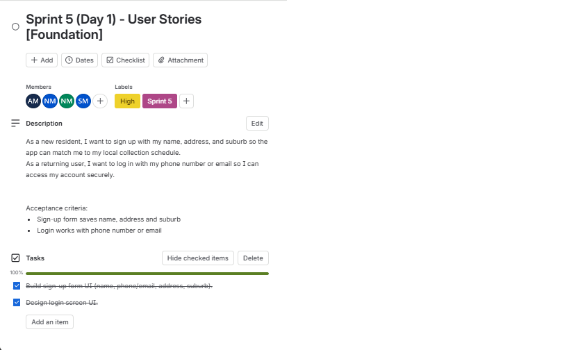

### 📝 Reflection on User Stories and Tasks (STAR Method)

**Situation**
Pretoria Prime Recycling needed its app features described clearly so every team member understood what to build for our Silver Lakes customers.

**Task**
Our task was to write user stories from the customer's point of view and break each one into smaller tasks the team could assign and complete.

**Action**
We wrote each story in the format "As a [user], I want [goal], so that [benefit]". We added acceptance criteria to each story, as our charter requires, and split every story into checklist tasks on Trello, such as building the sign-up form UI and the dashboard layout.

**Result**
✅ The team had a clear, shared understanding of what to deliver and what "done" looks like. I learned that thinking from the customer's side keeps work focused, and that small tasks make progress easier to track.

---

## 📋 Product Backlog

### 📸 Evidence
Product backlog for **Pretoria Prime Recycling** on Trello: 22 prioritised work items, labelled by priority and sprint.

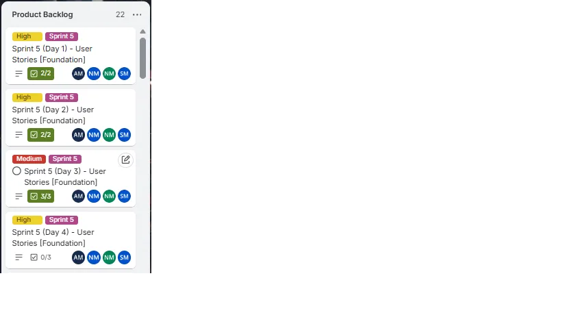

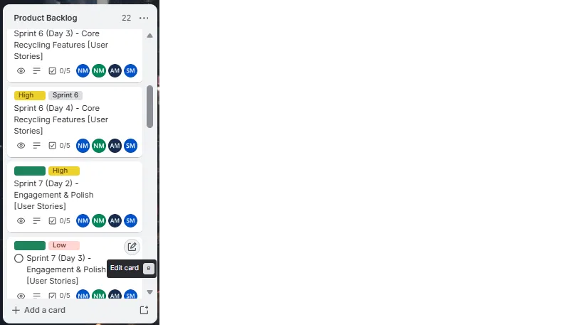

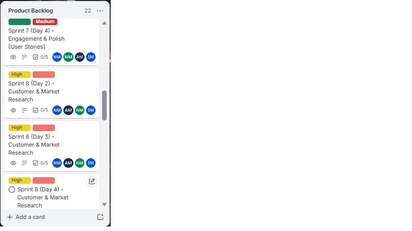

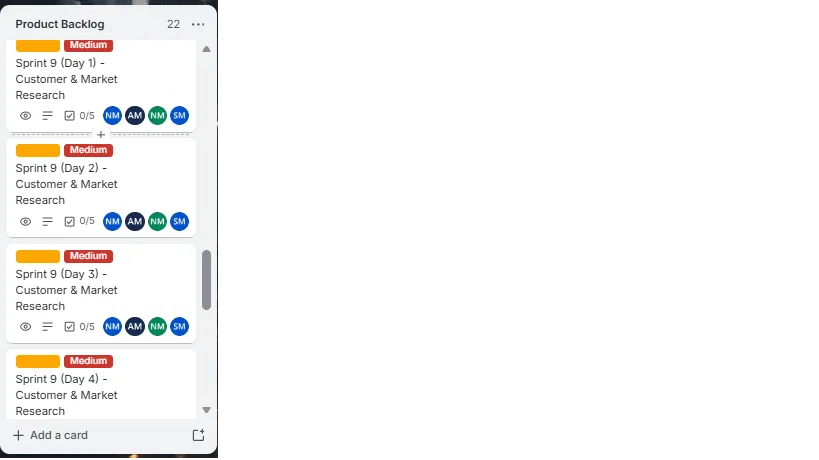

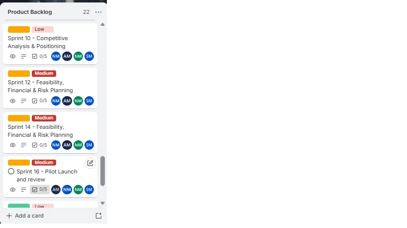

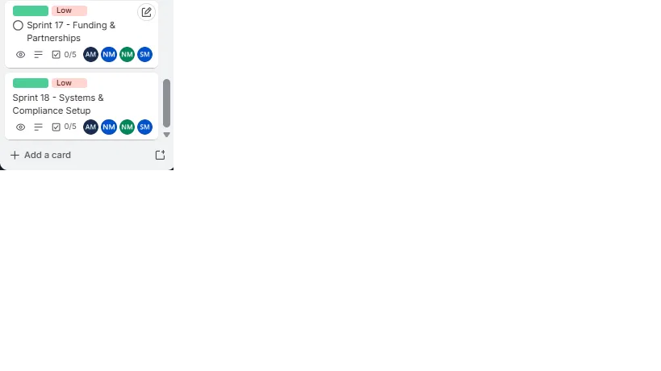

### 📝 Reflection on the Product Backlog (STAR Method)

**Situation**
Pretoria Prime Recycling had many features and activities to deliver, from the app foundation to market research, business planning and the pilot launch. Our team needed one place that showed all the work and what mattered most.

**Task**
Our task was to build a product backlog on Trello that listed every required item and ranked them by priority, so the team knew what to work on first.

**Action**
We created a Product Backlog list of 22 cards, grouped by sprint. Each card has a priority label (High, Medium or Low), a sprint label, a checklist of tasks and assigned team members. As Agile Lead, I helped keep the board organised so the team could see what was next.

**Result**
✅ The whole team could see all the work and its priority in one place. I learned that a backlog needs regular updating to stay useful, and that clear labels make planning sprints much easier.

---

## 🏃 Sprint Backlog

### 📸 Evidence
Sprint backlog for **Pretoria Prime Recycling** on Trello. Sprint work is tracked in the **In Progress** list and the **Completed Sprint Backlog** list, with sprint dates, task checklists and assigned team members.

**In Progress**

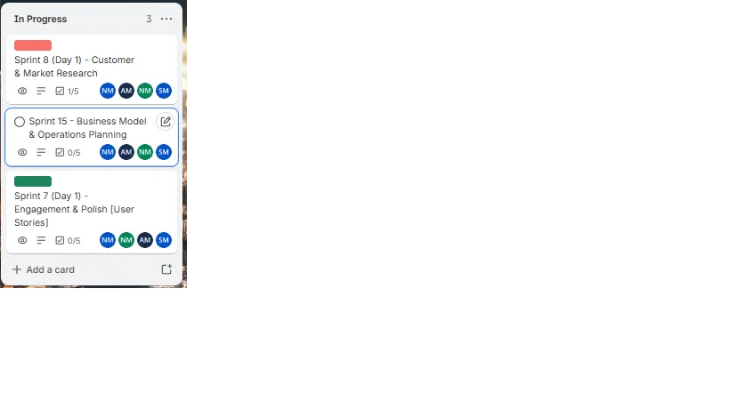

**Completed Sprint Backlog**

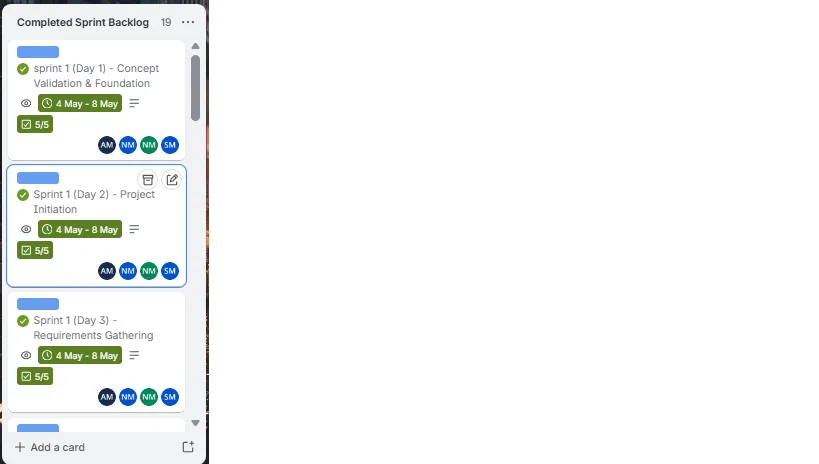

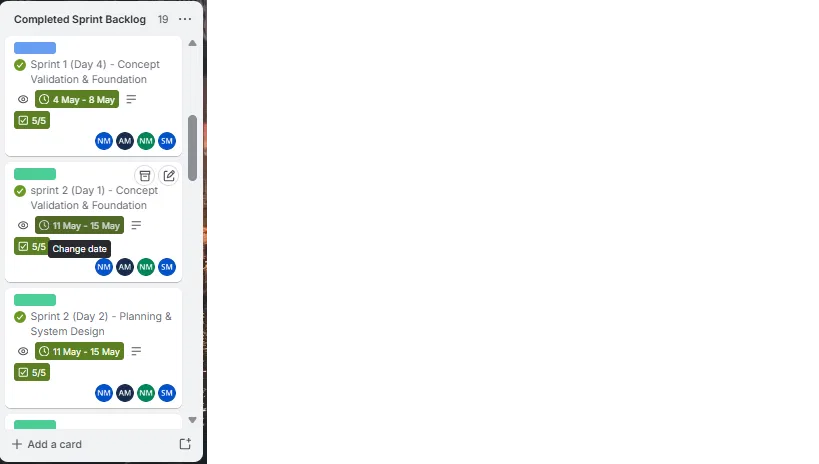

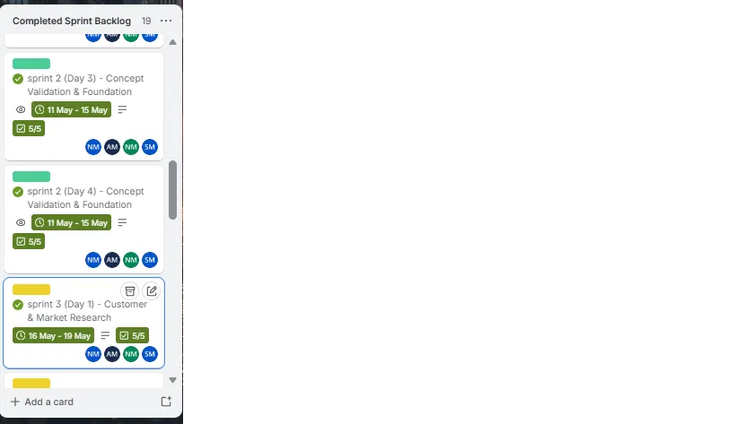

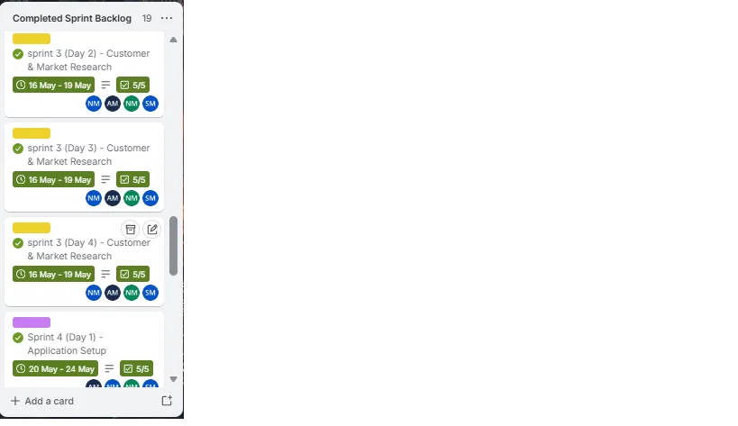

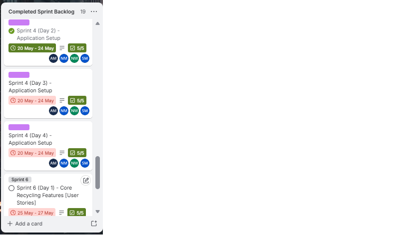

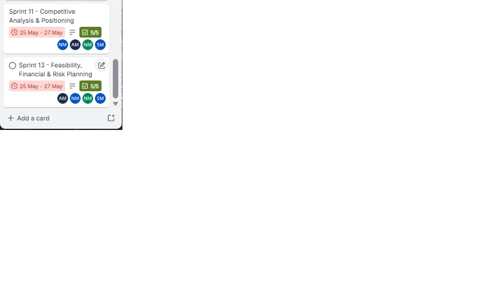

### 📝 Reflection on the Sprint Backlog (STAR Method)

**Situation**
After building our product backlog, Pretoria Prime Recycling needed to turn the big list of work into small, manageable pieces the team could finish within a sprint.

**Task**
Our task was to select work from the product backlog for each sprint, break it into tasks, assign it to team members and track progress until it was done.

**Action**
For each sprint, we took cards from the product backlog, gave them dates and checklists of tasks, and assigned team members. We tracked them in the In Progress list and moved a card to Completed Sprint Backlog once its work was done. As Agile Lead, I monitored progress on the board and raised blockers early, as our charter requires.

**Result**
✅ Completed sprint cards show fully ticked checklists (5/5) with sprint dates, and the In Progress list shows what the team is working on now. I learned that small, dated sprint goals make progress visible, and that a board only helps if it is kept up to date at the end of every sprint.
